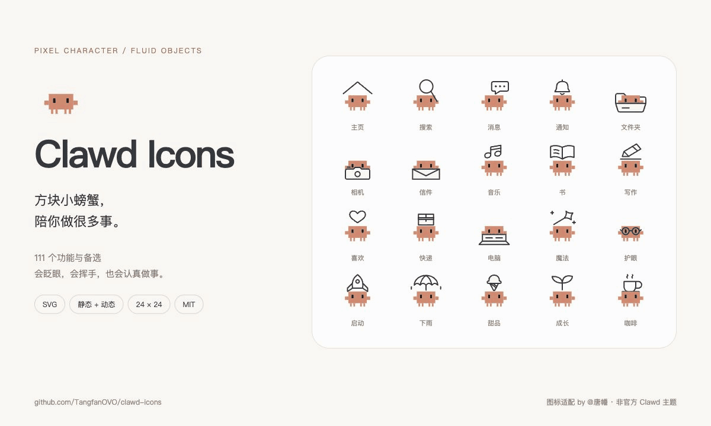
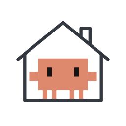
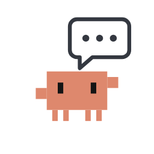
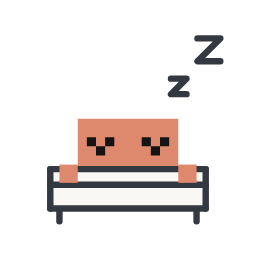

# Clawd Icons



111 个 Clawd 主题 SVG 图标：100 个功能、11 个备选画法。方块身体与手脚，流畅的细线物件；眼睛先看、手脚跟上，动作回应图标本身的意思。

**[在线图标库](https://TangfanOVO.github.io/clawd-icons/) · [动态预览](https://TangfanOVO.github.io/clawd-icons/interaction.html) · [状态条示例](https://TangfanOVO.github.io/clawd-icons/examples.html) · [单个下载](https://TangfanOVO.github.io/clawd-icons/motion/) · [灵动岛小螃蟹](https://TangfanOVO.github.io/clawd-icons/island/) · [下载整包](https://github.com/TangfanOVO/clawd-icons/releases/latest)**

24 × 24 画布 · 0.7 线宽 · 橙色方块角色 · 静态 SVG / 雪碧图 / CSS 动效 · 零运行时依赖。图标适配 by **唐幡 (TangfanOVO)**；Clawd 基础图形来源见 [署名说明](THIRD_PARTY.md)。

## 可以怎么用

| 场景 | 推荐搭配 |
| --- | --- |
| 导航、工具栏 | 静态图标用于识别，点击后播放一次专属动作 |
| 应用内状态条 | 搜索时探头、写作时动笔、完成时庆祝，旁边保留文字 |
| AI 助手与任务反馈 | 搜索、阅读、写作、等待、完成，跟随真实任务状态切换 |
| 空页面与完成提示 | 休息、收件箱、礼物、成长，给状态一点性格 |
| 聊天小反应 | 导出 GIF / WebP / PNG，表达招呼、喜欢、谢谢、晚安；按目标平台格式适配 |

[状态条示例](examples.html) 是可交互的网页演示，状态由按钮模拟。真正使用时请由应用的数据驱动，不用动画假装任务已完成。

iPhone 真正的灵动岛需要原生 App 通过 ActivityKit / WidgetKit 接入实时活动，并用 SwiftUI 适配界面与系统允许的动画；不能直接把网页 CSS 动效放进去。见 [Apple：Live Activities](https://developer.apple.com/documentation/widgetkit/liveactivities-collection)。

## 静态 SVG

```html

```

也可以固定版本使用 CDN：

```html

```

静态雪碧图：

```html
<svg width="24" height="24" role="img" aria-label="主页">
  <use href="sprite/clawd.svg#clawd-home"></use>
</svg>
```

SVG 可导入支持 SVG 的设计工具。图形没有脚本和外部引用。大部分物件线条使用 `currentColor`，但角色、眼睛与局部遮挡色有固定颜色；深色底上请检查对比度。

## 动态 SVG

动态版需要把 SVG 内联进页面，并引入两个文件。`` 和外部雪碧图 `<use>` 作为静态资源使用，不会由下面的运行时驱动。

```html
<link rel="stylesheet" href="motion/clawd-motion.css">
<button id="home" aria-label="主页">
  <!-- 在这里放入 svg/clawd-home.svg 的完整内容 -->
</button>
<script src="motion/clawd-motion.js"></script>
<script>
  const home = document.querySelector('#home');
  home.addEventListener('click', () => ClawdMotion.play(home));
</script>
```

```js
ClawdMotion.play(element);           // 图标自己的动作，返回完成 Promise
ClawdMotion.play(element, 'blink');  // 眨眼
ClawdMotion.play(element, 'happy');  // 开心
ClawdMotion.idle(element, true);     // 安静待机；false 关闭
ClawdMotion.asleep(element, true);   // 睡着；false 醒来
ClawdMotion.stop(element);          // 停止当前手势，保留待机设置
```

每次手势约 1.65 秒；重复点击不会排队。`--cr-speed: 2.5` 将时长放慢至 2.5 倍。系统设置“减少动态效果”时停止这些 CSS 动画；GIF 预览本身不受该设置控制。

React / Vue 中可将 SVG 作为内联组件，在挂载后把对应的 DOM 元素交给 `ClawdMotion`。仅使用 `img` 导入 SVG 不会激活动效。Android / iOS 原生界面可使用转换后的静态资源，动态部分需要按各平台重新实现。

## 生动版

主页、消息、书、睡眠多一种画法：动作更大，带笑眼、腮红这些表情。原来那版不变，两版都能用。

| 预览 | 图标 | 生动版动作 |
| --- | --- | --- |
|  | 主页 `clawd-home` | 伸个懒腰 |
|  | 消息 `clawd-chat` | 说完发出 |
|  | 书 `clawd-book` | 捧书翻页 |
|  | 睡眠 `clawd-sleep` | 偷看一眼 |

文件在 `motion/vivid/`，用法见 [motion/README.md](motion/README.md#生动版)。[单个下载](https://TangfanOVO.github.io/clawd-icons/motion/) 页面里选“生动版”，可以存静态 SVG、动态 SVG 或 GIF。

## 灵动岛小螃蟹

`island/` 里是六只放进 iPhone 灵动岛的像素小螃蟹：在钓鱼、惦记你身体、在给你写信、在看外面、出门走走、在挑吃的，每只 10 秒一圈。实时活动里放不了 GIF，它们靠计时器字体动起来，需要原生 App 接入。

| 想做什么 | 去哪儿 |
| --- | --- |
| 一只只保存 | [在线画廊](https://TangfanOVO.github.io/clawd-icons/island/)：每只都能存 SVG、GIF、灵动岛紧凑态和展开态 |
| 改动作、自己画一只、接进 App | [island/README.md](island/README.md)：原理、命令和 Swift 示例 |

## 预览与文件

- `svg/`：111 个独立静态 SVG；`motion/svg/` 提供相同的 111 个文件，便于单独拷贝动态包。
- `sprite/clawd.svg`：111 个静态 symbol。
- `motion/clawd-motion.css`、`motion/clawd-motion.js`：动效与状态控制。
- `icons.json`、`motion/motion.json`：名字、中文名、分类、备选关系与动作说明。
- `index.html`：搜索、复制、下载、尺寸与明暗背景预览。
- `interaction.html`：全套分组、慢放、动作进度定格。
- `examples.html`：应用内状态条与聊天反应的交互示例。
- `motion/index.html`：单个下载，选图标、版本、动作、颜色、背景和尺寸，存 SVG 或 GIF。
- `motion/vivid/`：主页、消息、书、睡眠的生动版，有动态源、静态 SVG 和预览 GIF。
- `island/`：灵动岛小螃蟹，带画廊页 `island/index.html`。
- `preview/cover.png`、`preview/cover.gif`：静态与动态封面。

[111 个静态图标总览](preview/all-icons.jpg) · 全套动图：[1](preview/all-1.gif) / [2](preview/all-2.gif) / [3](preview/all-3.gif) / [4](preview/all-4.gif)


## License & credits

[MIT](LICENSE)。保留版权和许可文本即可按协议使用；上游原文一并放在 [LICENSE.from-clawd-tank.txt](LICENSE.from-clawd-tank.txt)。

Clawd 是参考角色，本项目是非官方适配。基础图形出自 [clawd-tank](https://github.com/marciogranzotto/clawd-tank)，完整来源见 [THIRD_PARTY.md](THIRD_PARTY.md)。

小伙伴：[fanfan 图标](https://github.com/TangfanOVO/fanfan-icons) · [豹宝图标](https://github.com/TangfanOVO/baobao-icons)（各自按各自的许可使用）。

## English

111 functional SVG icons (100 concepts plus 11 alternatives) pair a coral pixel Clawd with thin, smooth objects. Every icon has a purpose-specific gesture, plus blink, happy, idle, and sleep states. Use SVG files or the sprite for static UI; inline the SVG and load the dependency-free CSS / JS for motion. Reduced-motion preferences are respected by the runtime. GIFs are preview media, not native iOS Dynamic Island components.

Any icon can be downloaded on its own as static SVG, animated SVG or GIF from the [download gallery](https://TangfanOVO.github.io/clawd-icons/motion/); home, chat, book and sleep also have a livelier vivid variant in `motion/vivid/`. `island/` holds six pixel crabs for the iPhone Dynamic Island, animated with timer fonts inside a Live Activity; see the [island gallery](https://TangfanOVO.github.io/clawd-icons/island/) and [island/README.md](island/README.md).

Adaptations by 唐幡 (TangfanOVO). Unofficial community project; upstream artwork attribution and MIT license are preserved.
