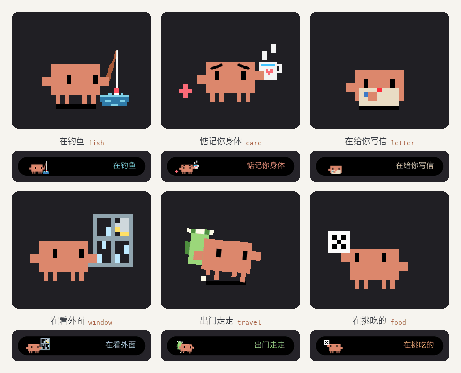




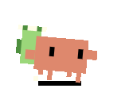
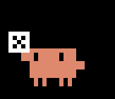

# 灵动岛小螃蟹

iPhone 灵动岛里一直在动的像素小螃蟹，六只，每只 10 秒一圈；外加一套工具，把带 CSS 动画的 SVG 变成「计时器字体」。by **唐幡 (TangfanOVO)**

**[在线画廊（一只只保存）](https://TangfanOVO.github.io/clawd-icons/island/) · [回图标库](../README.md)**

## 原理

实时活动里放不了 GIF，能自己动的只有 `Text(timerInterval:)`：字体把数字 0–9 画成十帧，秒的个位走到几就显示第几帧。四组计时器起点错开 0.25 秒；慢层（身子、眼睛、道具）一秒一个姿势、整块交给一组，快层（水花、心、星星）四组轮流，上面压四层黑蒙版盖掉熄灭的点，画面就能每 0.25 秒动一下。

## 六只

| | 状态 | 10 秒里在干嘛 | `--fast` | 计时器层数 |
| --- | --- | --- | --- | --- |
|  | `fish` 在钓鱼 | 等浮漂、打瞌睡、拽空了挠头、重新抛竿、钓上一条小鱼看一眼又放回水里 | `fx-ring,fx-drop,fx-bub` | 19 |
|  | `care` 惦记你身体 | 吹凉一杯热水，双手捧到你面前，等你接 | `steam,plus,heart` | 18 |
|  | `letter` 在给你写信 | 写两行、抬头想、写完折好装信封、贴心封口、举起来给你看 | `heart,ink` | 18 |
|  | `window` 在看外面 | 趴窗台听雨、伸钳子接雨、雨停了月亮出来、蹦起来 | `rain,star,splash` | 17 |
|  | `travel` 出门走走 | 背着登山包走路、跟飞过的鸟招手、东张西望、掏地图 | `bird,leaf,dust` | 18 |
|  | `food` 在挑吃的 | 摇骰子、扔出去、落地吓一跳、冒出一碗面、搓手 | `fx-tick,fx-star,fx-steam` | 20 |

每只一个文件夹：`gen.py` 生成同目录的 SVG，`smooth.gif` 是顺滑版，`island-compact.gif` / `island-expanded.gif` 是按计时器规矩算出来的灵动岛真实样子。六只的残影都是 0。

## 怎么用

下面的命令都在 `island/` 目录里跑。

| 想做什么 | 命令 |
| --- | --- |
| 改了动作，重新出 SVG | `python3 crabs/fish/gen.py` |
| 顺滑 GIF | `python3 tools/smooth.py crabs/fish/fish.svg crabs/fish/smooth.gif --len 10 --sheet out/fish-sheet.png` |
| 灵动岛真实显示（残影、层数、样机 GIF、`tiers.json`） | `python3 tools/from_svg.py fish 在钓鱼 "在湖边等鱼上钩" "#7FD1E8" crabs/fish/fish.svg --len 10 --box 144x96 --fast fx-ring,fx-drop,fx-bub`，结果写在 `out/fish/` |
| 让画廊用上新的灵动岛 GIF | `cp out/fish/island-compact.gif out/fish/island-expanded.gif crabs/fish/` |
| 造字体和 Swift 表 | `python3 tools/fonts.py fonts out/CrabStates2.swift 在钓鱼=fish`（多只就接着写 `名字=key`，每只要先跑过上一行的 from_svg） |
| 离线叠一遍字体看看 | `node tools/verify_fonts.mjs fonts out/CrabStates2.swift 在钓鱼 out/verify.png` |
| 重出上面那张六只一起动的预览 | `python3 tools/preview_grid.py`（读各只的 `smooth.gif` 和 `island-compact.gif`，写 `preview.gif`） |
| 接进 App | 照 [`swift/CrabFrames.swift`](swift/CrabFrames.swift)；`fonts/` 里的字体拖进 widget extension，`UIAppFonts` 里登记，`out/CrabStates2.swift` 一起加进去 |

需要 Python 3（Pillow、fontTools）、Node 18+、一个 Chromium。Chromium 先找 Playwright 装的那份，再找系统里的 Chrome，`CHROME=路径` 可以指定。样机上的中文字体用 `CRAB_FONT=路径` 指定。

## 自己画一只

| 规矩 | 为什么 |
| --- | --- |
| 一圈 10 秒，大东西一秒一个姿势，彼此要看得出不同 | 慢层一秒才换一次，连续的小位移在岛上只是抖 |
| 小东西一直往新地方走，一个点熄了要黑满 1 秒，别从慢层上面经过 | 不然蒙版盖不干净，留残影 |
| 慢层颜色数 + 快层颜色数 × 4 + 4 ≤ 20 | 一种颜色就是一层计时器，层越多越耗电 |
| 整数格方块，`shape-rendering="crispEdges"`，不要渐变和滤镜 | 字体里一格就是一个方块 |

苹果没说支持这种用法，可能多耗一点电，建议在 App 里做成开关。

## 许可

| 部分 | 许可 |
| --- | --- |
| 代码、六只的动作、表情和道具 | MIT，见仓库根目录的 [LICENSE](../LICENSE) |
| 螃蟹身子（躯干、手、腿、眼睛、地上的影子） | 就是 [marciogranzotto/clawd-tank](https://github.com/marciogranzotto/clawd-tank/blob/a8942d140eeb8bcf549857ad599f7d62fd29eb01/assets/svg-animations/clawd-static-base.svg) 的静态底，腿也是原版的长短；MIT，见 [LICENSE.from-clawd-tank.txt](../LICENSE.from-clawd-tank.txt) |
| Clawd 这个角色 | 归 Anthropic。这是非官方的粉丝作品，跟 Anthropic 没有合作，也没有背书 |
| 动作的视觉参考 | [rullerzhou-afk/clawd-on-desk](https://github.com/rullerzhou-afk/clawd-on-desk)。那边的美术保留所有权利，本仓库没有复制其中的程序或美术，见 [THIRD_PARTY.md](../THIRD_PARTY.md) |
